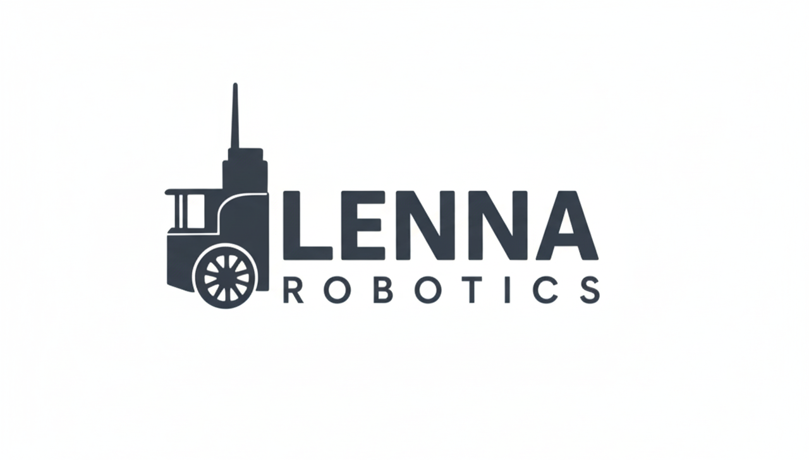
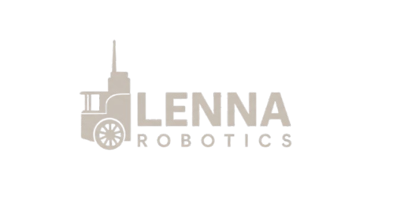

  true friendship builds dreams

  <!-- Light mode logo -->
  

  <!-- Dark mode logo -->
  

<h1 align="center">
  Lenna Robotics Research Lab
</h1>

  <em>Exploring the frontiers of autonomous systems at Iran University of Science and Technology.</em>
   
   
  
  
  

---

## 🤖 About Us

Welcome! We started as a robotics research team based in the Robotics Research Lab at the Electrical Engineering Research Labs Center at **Iran University of Science and Technology** under the supervision of [Dr. S. M. Esmailzadeh](https://scholar.google.com/citations?user=BbeZxAQAAAAJ&hl=en).

Founded in Winter 2023, we began by exploring a range of robotics topics that led to the development of two core platforms:  
- A **self-balancing robot**  
- An **autonomous mobile robot**  

Since Summer 2023, our primary focus has been advancing mobile robotics through our flagship **LMRO** platform, with an ongoing **ROS 2** implementation known as **LMR2**.  

Lenna Robotics Lab has also expanded into teleoperation research, investigating control schemes for a **2‑DOF serial link teleoperation robot** under **time-delay** conditions.

---

## 🚀 Our Projects

Here's a look at what we've been working on.
### 1. Lenna Mobile Robot
* **Description:** The core hardware and simulation resources common to all Lenna mobile robot platforms. 
* **Repositories:** [LMR-MCU-Board](https://github.com/Lenna-Robotics-Research-Lab/LMRO-MCU-Board), [LMR-Simulation](https://github.com/Lenna-Robotics-Research-Lab/LMRO-Simulation), [LMR-CAD](https://github.com/Lenna-Robotics-Research-Lab/LMRO-CAD), [LMR-Communication-Shield](https://github.com/Lenna-Robotics-Research-Lab/LMRO-Communication-Shield)
  
### 2. Lenna Mobile Robot ONE (LMRO) Project 
* **Description:** A completed ROS melodic/noetic based autonomous mobile robot platform. It features a distributed control architecture that separates high-level processing (NVIDIA Jetson nano b0) from real-time hardware control (a custom ARM-based embedded board, the "Bardia Board") . This repository serves as the full documentation for the robot's software stack and user manual 
* **Status:** Completed / Archived
* **Repositories:** [Lenna-Mobile-Robot-ONE](https://github.com/Lenna-Robotics-Research-Lab/Lenna-Mobile-Robot-ONE), 

### 3. Lenna Mobile Robot 2 (LMR2) Project
* **Description:** An upcoming ROS2-based successor to the LMRO. It utilizes the same distributed control architecture and real-time embedded board as the LMRO project but replaces the high-level ROS1 software stack with ROS2.
* **Status:** Pending Launch 
* **Repositories:** [Lenna-Stereo-Camera](https://github.com/Lenna-Robotics-Research-Lab/Lenna-Stereo-Camera)
  
### 4. Lenna TeleOperation Robot 1 (LTOR1) Project
*  **Description:** A control scheme for a teleoperation robot with time delay.
*  **Status:** Under Research

### 5. Lenna Self-Balancing Robot (LSBR) Project
* **Description:** Our exploration into dynamic stability and control theory, developed as the capstone project for the mechatronics course (Spring 2022) at Iran University of Science and Technology.
* **Status:** Completed
* **Repository:** [Lenna-Self-Balancing-Robot](https://github.com/Lenna-Robotics-Research-Lab/Lenna-Self-Balancing-Robot)

---

## 📧 Contact & Inquiries

We are passionate about sharing our work and collaborating with others. If you have any questions or are interested in our research, please reach out to us!

-   **Organization Contact:** [lenna.robotics@gmail.com](mailto:lenna.robotics@gmail.com)
-   **Contacts:**
    -   Erfan Riazati: [erf.riazati@gmail.com](mailto:erf.riazati@gmail.com)
    -   Arian Hajizadeh: [rian.hajizadeh@gmail.com](mailto:rian.hajizadeh@gmail.com)
